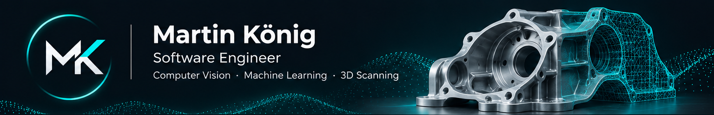

  

Hi, I'm Martin 👋
I'm a software engineer who enjoys building high-performance applications, exploring new technologies, and turning ambitious ideas into working systems.

My work spans computer vision, machine learning, and hardware-integrated software — from early prototypes to production-oriented applications. I care about clean architecture, measurable performance, maintainability, and software that behaves reliably beyond the happy path.
Featured project: Mantis Studio
Open-source, modular 3D scanning software

Mantis Studio is a C++23 / Qt 6 platform for acquisition, calibration, reproducible data processing, and 3D visualization. It combines a device-owning daemon with desktop, CLI, and SDK clients and an extensible plugin architecture.

It's developed alongside Mantis X1, an experimental handheld 3D laser scanner.
Development status: Mantis Studio is an active engineering project, not a finished or accuracy-certified 3D scanner. The screenshot shows the actual Qt application with illustrative demo data. See the roadmap for progress and planned capabilities.

Explore Mantis Studio →
Areas I work on
- Computer vision & machine learning — practical vision systems and end-to-end ML workflows.
- 3D scanning & reconstruction — acquisition, calibration, geometry, and visualization.
- High-performance software — C++, Python, resource-conscious system design.
- Embedded Linux & hardware integration — cameras, sensors, and device-facing software.
- Software architecture & reliability — maintainable interfaces, testing, and fault handling.
- AI-assisted development — using coding agents with engineering review and verification.
Support open source
I work on open-source projects because I enjoy building, experimenting, and sharing what I learn. Support helps fund hardware prototypes, components, and testing.

☕ Buy Me a Coffee · PayPal
<!-- GitHub Sponsors: add a profile link after approval. -->
